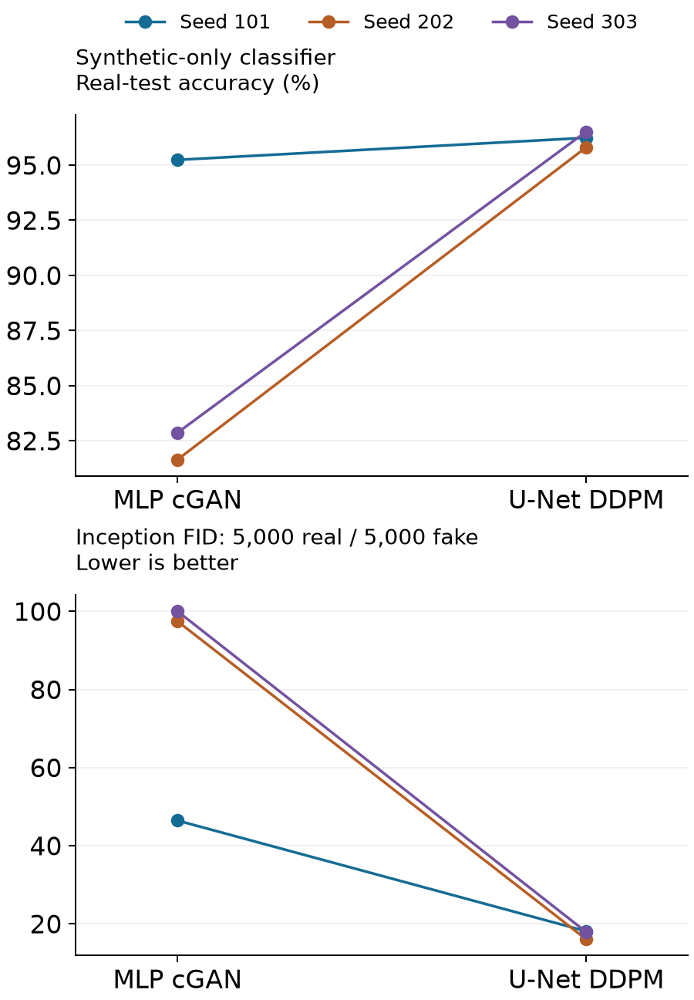
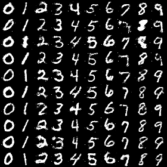
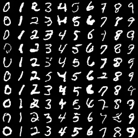

# Conditional Handwriting Generation

Train an MLP conditional GAN and a class-conditioned residual U-Net diffusion model, then inspect what their synthetic digits teach a classifier.


## Fresh training: every seed visible

**Six complete generator runs** on MNIST: three 50-epoch cGANs and three 40-epoch DDPMs, followed by 10,000 generated images and a 20-epoch synthetic-only classifier for each. Mean real-test accuracy ± sample SD across three pipeline seeds: **cGAN 86.59% ± 7.52 pp**, **DDPM 96.19% ± 0.36 pp**.



Training budgets and devices differ, so this is not a compute-matched efficiency claim. Three seed pairs are descriptive. [All results, budgets, per-class diagnostics and limitations](results/comparison-v1/RESULTS.md).

Actual first 100 generated samples for seed 101, columns 0–9:

MLP cGAN:



Residual U-Net DDPM:



All three seeds' grids, histories, confusion matrices, portable generator/classifier weights and exact executed source are in [comparison-v1](results/comparison-v1). The cGAN mechanism above uses fully connected layers; the compact convolutional `digit_models.py` examples are a separate implementation.

## Train and evaluate

Python 3.14.3 and the [pinned Mac reference](requirements-reference-macos.txt) describe the recorded training environment. Acquire the canonical MNIST archive as documented in [DATA.md](DATA.md); the trainer checks its hash.

```sh
python -m pip install -r requirements-reference-macos.txt
python comparison.py --data /path/to/mnist.npz --out runs/comparison
python verify_comparison.py --data /path/to/mnist.npz --results results/comparison-v1
```

This launches the fixed six-run protocol on CPU and Apple Silicon MPS. [Direct commands, fresh FID and archived experiments](BENCHMARKS.md) · [versioned profiles](reproduction.json).

## Try a small example

```sh
python examples/quickstart.py
```

The randomly initialized example produces a conditioned batch `[4, 1, 28, 28]`, discriminator scores `[4, 1]`, and bounded outputs. [Observed output](examples/expected-output.txt). It checks an interface, not sample quality.

## Stop and continue

```sh
python train.py --data /path/to/mnist.npz --model cgan --epochs 10 --output runs/first --device cpu
python train.py --data /path/to/mnist.npz --model cgan --epochs 50 --resume runs/first/training-state.pt --output runs/continued --device cpu
```

The total target epoch is supplied with `--epochs`; continuation requires identical data, batch, seed, device and Torch version, plus a new output directory. Session state includes models, optimizers and loader/random states. Inference weights cannot resume training. Small CPU fixtures match exactly; **full-data MPS continuation showed numerical drift** despite matching configuration and captured RNG state. [Measured qualification](MPS_REPRODUCIBILITY.md).

## Check the implementation

```sh
python run_reproduction.py --profile checks --output runs/checks
```

The checks protect conditional shapes, bounded generation, adversarial/diffusion gradients, restored architectures, split CPU continuation and complete paired-result accounting. [Validation scope](VALIDATION.md).

## Earlier evidence

The earlier single fresh cGAN run reached 93.28%; recovered cGAN utility reached 93.03%. The archived study reports cGAN/DDPM FID 51.94/7.28 and T4 generation timings. These are separate records. The new six-run comparison and fresh FID protocol do not recertify those historical measurements. [Provenance and comparisons](BENCHMARKS.md).

## Reuse

Original tooling has a file-scoped [MIT grant](LICENSING.md). Upstream source credits, datasets and checkpoint terms remain separate. These digit-generation experiments do not establish CAPTCHA resistance or a client deployment.
