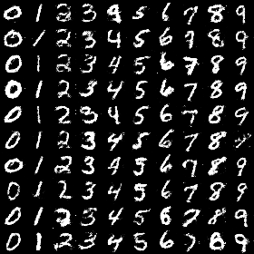

# Conditional Handwriting Generation

Explore the quality–latency trade-off between adversarial and diffusion-based digit generation.

## Implementation

The headline cGAN uses fully connected layers with learned class embeddings. The second training path uses a residual U-Net DDPM. Compact convolutional examples in `digit_models.py` are separate implementations and do not produce the headline cGAN result.


## Train and sample generative models

A fresh **50-epoch MLP cGAN** run produces samples that train a classifier to **93.28% accuracy on 10,000 real MNIST test images**. The classifier sees only 10,000 synthetic training images and trains for 20 epochs. Original MLP cGAN and residual U-Net DDPM training/sampling paths also retain compatible recovered checkpoints.



[Fresh training, utility metrics and checkpoint provenance](results/fresh-cgan/protocol.json). One generator seed and one classifier seed do not establish superiority. The separate recovered-cGAN utility result remains **93.03%**.

[Commands, artifacts and benchmark scope](BENCHMARKS.md) · [Versioned profiles](reproduction.json)

Recovered cGAN checkpoint, class-conditioned columns 0–9:


Recovered residual U-Net DDPM, same class order:


## Try a small example

Randomly initialized components produce a conditioned batch and discriminator scores. Shapes and output bounds do not establish generated-image quality or reproduce the historical FID study.

After the local setup below, run from the repository root:

```sh
python examples/quickstart.py
```

The [example source](examples/quickstart.py), [captured output](examples/expected-output.txt) and [execution record](examples/environment.json) keep this demonstration inspectable. Floating-point values may vary with library versions.

Observed output from this run:

```text
{'images': [4, 1, 28, 28], 'scores': [4, 1], 'bounded': True}
```

## Evidence and results

The completed MNIST study records cGAN FID 51.94 versus diffusion FID 7.28, with synthetic-only classifier real-test accuracy of 92.97% and 97.25%. Recorded generation time for 10,000 samples is 0.269 versus 255.235 seconds on a T4. These figures describe the saved original experiment, not the newly refactored components.

The fresh 50-epoch cGAN run and the recovered-weight utility evaluation have separate records. Neither recertifies the archived FID or T4 latency results. Full DDPM training has not been repeated in this release; its recovered checkpoint and short training checks have separate scope.

## Run the checks

Python 3.11 or later.

```sh
python -m venv .venv
source .venv/bin/activate
python -m pip install -r requirements.txt
python smoke_test.py
python test_restored_models.py
python test_resume.py
```

See [DATA.md](DATA.md) for input contracts and [VALIDATION.md](VALIDATION.md) for the verification scope. 

## Practical relevance and limitations

FID uses natural-image features and is imperfect for digit images. One seed does not establish generalization or CAPTCHA resistance. The fresh cGAN run repeats the declared training budget on a different runtime; the full archived FID/latency study and full DDPM training remain unreplicated.

No client deployment, commercial outcome, or new live-provider performance is inferred from the component tests.

## Train, stop and continue

CPU is the reference device. Select `--device mps` for an Apple Silicon GPU or `--device cuda` for CUDA. Each resumed session must keep its data, batch size, seed, device and PyTorch version unchanged. `--epochs` is the total target, and each command needs a new empty output directory.

```sh
python train.py --data /path/to/mnist.npz --model cgan --epochs 10 --output runs/first --device mps
python train.py --data /path/to/mnist.npz --model cgan --epochs 50 --resume runs/first/training-state.pt --output runs/continued --device mps
```

`training-state.pt` contains both networks and optimizers, completed epochs, history, CPU/accelerator random states and shuffled-loader state. Recovered inference weights are not resume checkpoints. The offline continuation test compares full training with a split-and-resumed run for both architectures on generated fixtures; this is not a generation-quality benchmark. CPU/GPU numerical results are not interchangeable.

## Reuse

Original reproduction and validation tooling is available under MIT; see [LICENSING.md](LICENSING.md) for the explicit file scope and preserved upstream, dataset and checkpoint terms.
