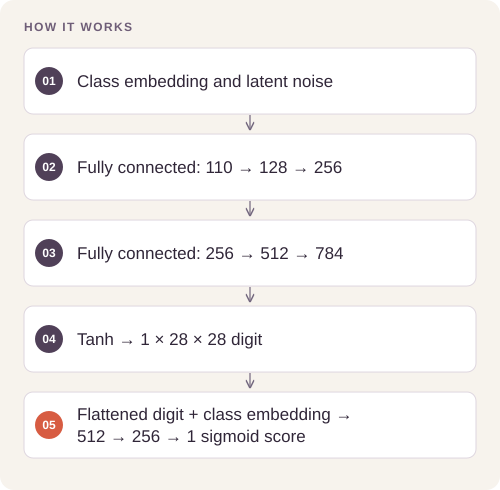
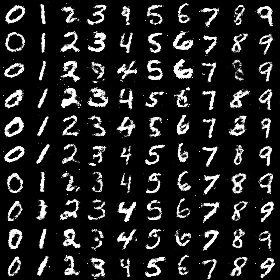
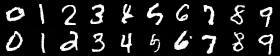

# Conditional Handwriting Generation

Explore the quality–latency trade-off between adversarial and diffusion-based digit generation.

## Implementation

Standalone conditioned generator/discriminator components, a conditioned noise predictor, and a cosine-schedule diffusion objective.




## Train and sample generative models

Complete original **MLP cGAN** and **residual U-Net DDPM** training/sampling paths are restored with strictly compatible retained checkpoints. A fresh classifier trained only on 10,000 cGAN samples reaches **93.03% on 10,000 real MNIST test images** under the declared 20-epoch utility protocol.

[Commands, artifacts and benchmark scope](BENCHMARKS.md) · [Versioned profiles](reproduction.json)

Recovered cGAN checkpoint, class-conditioned rows0–9:



Recovered residual U-Net DDPM, same class order:




## Try a small example

Randomly initialized components produce a conditioned batch and discriminator scores. Shapes and output bounds do not establish generated-image quality or reproduce the historical FID study.

After the local setup below, run from the repository root:

```sh
python examples/quickstart.py
```

The [example source](examples/quickstart.py), [captured output](examples/expected-output.txt) and [execution record](examples/environment.json) keep this demonstration inspectable. Floating-point values may vary with library versions.

Observed output from this run:

```text
{'images': [4, 1, 28, 28], 'scores': [4, 1], 'bounded': True}
```

## Evidence and results

The completed MNIST study records cGAN FID 51.94 versus diffusion FID 7.28, with synthetic-only classifier real-test accuracy of 92.97% and 97.25%. Recorded generation time for 10,000 samples is 0.269 versus 255.235 seconds on a T4. These figures describe the saved original experiment, not the newly refactored components.

This public edition contains a standalone refactor and focused tests. Saved experimental outcomes and the current component checks have separate scopes; the refactor has not been used to recertify the original benchmark.

## Run the checks

Python 3.11 or later.

```sh
python -m venv .venv
source .venv/bin/activate
python -m pip install -r requirements.txt
python smoke_test.py
```

See [DATA.md](DATA.md) for input contracts and [VALIDATION.md](VALIDATION.md) for the verification scope. 

## Practical relevance and limitations

FID uses natural-image features and is imperfect for digit images. One seed does not establish generalization or CAPTCHA resistance. The standalone component edition is not a new reproduction of the full archived training run.

No client deployment, commercial outcome, or new live-provider performance is inferred from the component tests.
